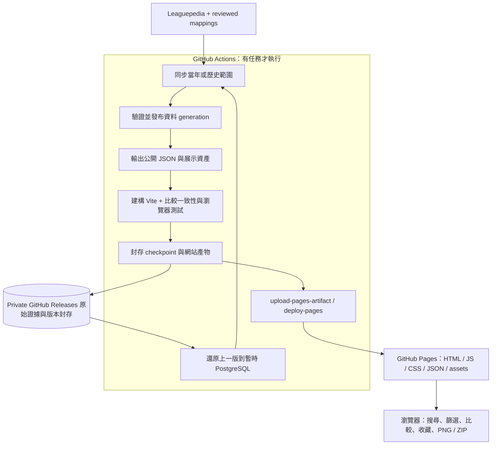

# GitHub Pages + GitHub Actions 架構研究草案

日期：2026-09-14（Asia/Taipei）
狀態：使用者已選定完全 GitHub 託管；本文件為目標設計，尚未實作，不取代現行部署基線。
起點：`main` / `53095f2`，工作目錄乾淨。
研究分支：`design/github-pages-actions`。

實作與退役流程見 [GitHub-only 遷移計畫](aegis/plans/2026-09-14-github-only-migration.md)。

## 結論與選項

可行，但需要把「伺服器即時查資料庫」改為「Actions 產生資料快照，瀏覽器查詢快照」。
GitHub Pages 只提供靜態網站，不能直接執行現有 Fastify API 或常駐同步程序。[1]
React、Vite、TypeScript、React Query 與瀏覽器端 PNG/ZIP 匯出可沿用。

| 選項 | 網站執行環境 | 資料處理與保存 | 評估 |
| --- | --- | --- | --- |
| A：只搬前端 | Pages + 外部 Fastify API | 常駐 PostgreSQL、S3、同步服務 | 變更較小，但維運簡化有限，另需處理跨域 |
| B：靜態查詢，保留證據儲存 | Pages + 瀏覽器查詢 JSON | Actions 暫時 PostgreSQL + 持久 S3 | 不採用：仍需外部持久儲存 |
| C：僅使用 GitHub 基礎設施 | Pages + 瀏覽器查詢 JSON | Actions 暫時 PostgreSQL + GitHub Releases 版本封存 | **已選定方向**：移除常駐 API、資料庫、S3 與排程主機 |

網站 repo 保存程式碼並部署 Pages；另以 private 資料 repo 的 Releases 保存完整資料庫備份與原始證據。
Actions 透過限縮至資料 repo 的憑證存取封存，公開網站只接收允許發布的 JSON 與展示資產。
這裡的 GitHub-only 指維運與持久儲存；Leaguepedia 仍是外部資料來源，套件 registry 仍是建構相依。
現階段不引入 Next.js、SSR 或瀏覽器 SQL/WASM；先量測 JSON 是否已足夠。

## 設計草圖（GitHub-only）



PostgreSQL 僅在 Actions job 內存在，用來重用現有 migration、sync、publication 與驗證。
每次資料更新先還原 checkpoint，不能只同步當年就把歷史資料覆蓋掉。
Releases 保留原始證據、版本化資料庫 dump、公開快照及網站產物；dump 不放到 Pages。
程式碼更新可直接使用已驗證的資料快照建構網站，不必每次重抓 Leaguepedia。
同步在 runner 的 filesystem ObjectStore 暫存物件，完成檢查與遠端封存後才成為有效 checkpoint。
資料 release、網站 release、失敗 attempt 分開標記；不得把不完整候選版本當成下次還原基準。

## 專案實際需要改動的地方

| 現有位置／功能 | 靜態方案的變更 |
| --- | --- |
| `apps/web/src/api/client.ts` | 現在呼叫根目錄 `/api/entities`、`/api/comparisons`；新增靜態資料實作，維持 `ComparisonApi` 的 UI 呼叫介面 |
| `apps/web/vite.config.ts` | 正式建構改接靜態 runtime；設定 Pages `base`，避免落入 development/test 的 mock runtime |
| `packages/database/src/repositories/comparison.ts` | SQL 目前掌握正式比較語意；靜態引擎須對照日期、league、逐局上場、team era、退休 facts、分頁與摘要規則 |
| `packages/domain/src/comparison.ts` | 可重用純 TypeScript 規則，但目前不是完整 SQL 替代品，例如缺少 `leagues` 篩選與完整 response 組裝 |
| `packages/database/src/repositories/entities.ts` | 匯出可見 entity、player ID、本名、可搜尋 alias、team era；保留搜尋包含匹配與種類篩選，排序差異需明確驗證 |
| `apps/server/src/avatar.ts`、media routes | 重用單一 v2 生成器，在建構時輸出展示資產；僅複製已通過授權檢查的 retained media |
| `packages/sync`、server CLI | CLI 移至 `apps/data`；沿用單一 Leaguepedia provider、migration 與 reviewed mappings，S3 改為 filesystem ObjectStore + Release 封存 |
| `apps/web/src/features/export`、`storage.ts` | 收藏已在 localStorage；匯出已在瀏覽器，但分頁取全資料與同源資產 URL 都要改接同一快照 |

正式靜態網站不得偷偷退回 HTTP API 或 mock。舊 Docker／SQL 路徑只作遷移期間的對照；
通過計畫的驗收後移除主分支舊程式，舊 commit 與獨立備份保留回復能力。
此草案不刪除資料、volume 或現有程式；永久刪除實體資料不屬於遷移必要步驟。

## 公開資料格式與查詢

建議輸出以下結構；檔名與 schema 是待實作的設計，不是既有指令產物：

```text
dist/
  index.html
  assets/...
  data/manifest.json
  data/<snapshot-id>/entities.json
  data/<snapshot-id>/filters.json
  data/<snapshot-id>/worlds/2025.json
  data/<snapshot-id>/msi/2026.json
  presentation/<content-hash>.svg
```

- manifest 包含 `schemaVersion`、snapshot ID、dataset version、程式 commit、產生時間、各 scope 的最後成功檢查時間、coverage、檔案路徑與 checksum。snapshot ID 涵蓋 metadata，因此 unchanged sync 更新 checkedAt 時也不覆寫舊路徑。
- 比賽快照保留 series、逐局 game、當時雙方隊伍／隊史／賽區及逐局 player membership；只匯出指定 generation 的有效 facts。
- 先載入 manifest 與搜尋索引，再按查詢年份／賽事下載分片；不限範圍時仍需載入所有相關分片。
- 不預先產生所有兩兩比較。瀏覽器篩選原始 facts 並彙總；量測主執行緒負擔後再決定是否加入 Web Worker。
- 每次比較與完整匯出鎖定同一個 manifest。資料更新不應讓分頁、總計或 PNG/ZIP 混用版本。
- 查詢分片缺失、checksum 不符或載入失敗時顯示錯誤，不把未載入資料算作零場對戰。
- 新部署至少附帶上一個完整公開版本；更舊分頁若遇到版本檔案不存在，要求重新載入，不透明混入新版。
- 搜尋保留 `Faker (Lee Sang-hyeok)`；歷史列使用參賽 team/team-era 名稱；字母頭像保留 v2 的 2–3 字元與賽區差異。
- 建構產生的頭像是可重建的展示產物，不是 provider 證據。將 Fastify 即時產生改為發布資產，需在正式採納時修訂 ADR 的 owner、URL 與 cache 邊界。

## Actions 建構與部署流程

使用獨立 `ci.yml` 與單一 `publish.yml`；後者統一所有正式資料寫入及部署入口：

1. **程式碼 CI／部署**：PR 執行離線 fixture 與快照契約測試；`main` push 讀取最新相容的已驗證快照，建構及部署。PR 不取用正式儲存 secrets、不發布正式 Pages。schema 不相容時擋下發布，改走明確的資料 migration 工作。
2. **資料更新**：`schedule` 每日更新明確設定的當年 scopes，每週更新歷史 scopes；`workflow_dispatch` 可手動重試或指定已審核範圍。不得推測未知賽事 mapping。
3. **環境準備**：安裝 repo 鎖定的 Node/pnpm 與相依，`pnpm install --frozen-lockfile`；資料更新 job 啟動暫時 PostgreSQL，還原及 migrate 後執行現有一次性同步 CLI。
4. **資料驗證與輸出**：檢查完整性、來源與歷史 acceptance；新增 exporter 產出公開快照。exporter 與靜態 runtime 目前尚不存在。
5. **建構**：先 `pnpm build` 編譯 workspace，再 `pnpm --filter @riftversus/web build` 產生 Vite 網站。根目錄目前的 `pnpm build` 只有 `tsc -b`，不能當成完整網站建構。
6. **驗收與封存**：遷移期比較 SQL／靜態引擎輸出，執行 Pages base path 的 Playwright；保存版本 dump、manifest、物件 packs、快照與 checksum 到資料 repo Release，完整還原驗證通過才發布 checkpoint。網站 bundle 另行封存。
7. **發布**：設定 Pages Source 為 GitHub Actions，使用 `configure-pages` → `upload-pages-artifact` → `deploy-pages`。部署 job 透過 `needs` 等待建構，使用 `github-pages` environment 與 `pages: write`、`id-token: write`；其他 job 僅取得所需權限。[2]

Action 版本在實作時依官方 release 鎖定 commit SHA；草案不提供看似可直接執行、實際缺 exporter 的 workflow。
資料發布不取消執行中的封存／部署，並避免較舊 snapshot 覆蓋較新的已部署版本。
已驗證 checkpoint 決定後續同步基準；GitHub Pages deployment 紀錄搭配站台 manifest 決定網站版本。
checkpoint 成功但網站部署失敗時，保留 checkpoint 並重試部署，不將同步狀態回退。
不依賴以 `GITHUB_TOKEN` 建立 Release 的事件啟動另一條 workflow；發布 job 在同一 workflow 直接串接。[8]

GitHub 排程可能延遲或丟棄，且只在 default branch 執行；公開 repo 無活動 60 天會自動停用排程。
建議避開整點，例如 UTC `17 19 * * *`（台北每日 03:17），並保留手動更新入口。
目前研究分支不會因加入 schedule 就取得定時執行。[3]

## Pages 限制與恢復

- Project Pages 使用 `/<repository>/`，本專案預期為 `/RiftVersus/`。Vite `base`、資產／JSON URL、匯出 URL 與 Router basename 都需一致；自訂網域則使用 `/`。[1][4]
- 目前主要頁面透過 query string 保存比較，可保留 `/RiftVersus/?...`，先不增加需伺服器 rewrite 的深層路由。舊網域的 localStorage 收藏不會自動轉移。
- Published site 上限 1 GB、每月頻寬 soft limit 100 GB；Pages deployment 超過 10 分鐘會 timeout。自訂 Actions workflow 豁免每小時 10 builds 的 soft limit，但不豁免其他限制。[5]
- 上述 10 分鐘是 Pages deployment 限制，不應誤當整個資料抓取 job 的時間上限。實際 backfill 時間、runner 資源與 Actions 配額仍需測量。
- 公開 repo 的標準 GitHub-hosted runner 使用免費；private repo 依方案有分鐘數與儲存額度。完全 GitHub 託管不等於未量測即可承諾零成本。[6]
- 每個 Release asset 小於 2 GiB、每個 Release 最多 1,000 assets；計畫採分片 packs 並保留完整物件索引。[7]
- Pages 產物只含可公開 facts、來源註記、coverage 與合規展示資產；不包含 DB dump、私有 raw envelope、GitHub 憑證或內部操作紀錄。
- 任一同步／驗證／封存失敗時不部署，保留上次成功網站；coverage 與最後成功檢查時間讓使用者辨識舊資料。
- 回復使用保留的「網站程式＋相同版本資料」bundle 重新部署；資料處理另從 Release 的 dump 與原始證據 packs 恢復。Actions cache 或短期 artifact 不作唯一還原依據。

## 建議的第一個實驗與驗收

先從現有已發布 generation 匯出資料，離線產生靜態網站，確認可用之後再接入 Actions 與線上同步。
第一個實驗不改資料來源，也不執行完整重新爬取。

1. 同一快照對照現有 SQL：選手／戰隊／賽區、日期、league、BO、team era、換人、分頁與總計一致；既有 pinned 歷史 acceptance 仍成立。
2. 完全關閉後端可搜尋／比較／分享／收藏／匯出；瀏覽器沒有 `/api` 或 Leaguepedia 請求。
3. 以正式 production build 測試 `/RiftVersus/` 與 query URL 重新整理、桌面／手機、頭像、PNG/ZIP；確定未接到 mock runtime。
4. 測量快照原始與壓縮大小、首屏下載量、最廣範圍查詢時間、手機記憶體及 UI 停頓；再決定分片粒度／Worker。既有記錄的 1,066 series / 1,664 games 只是上次運行證據，不是本次即時量測或容量結論。
5. 驗證排程部分失敗、整個 runner 重建、manifest 與分片不一致、部署中斷與上一版恢復；歷史 scopes 不遺失。

本次僅核對 repository 與官方文件，未量測靜態資料大小、未啟用 Actions／Pages、未驗證 GitHub runner 對來源與儲存的連線。
現有 runtime 架構仍以 README、部署文件、ADR-0001 及 identity/avatar v2 baseline 為準。
每日與每週更新沿用既有頻率，接受 Actions 非準時觸發的限制；完全移除外部 S3 已由使用者確認。
遠端 repository、Pages、private 封存 repo 與存取權限尚未設定；具體準備與驗收見遷移計畫。

## 研究來源

官方文件透過網頁檢索／擷取核對；查閱日期為上述研究日期。

1. GitHub Pages 定義：<https://docs.github.com/en/pages/getting-started-with-github-pages/what-is-github-pages>
2. Custom workflows：<https://docs.github.com/en/pages/getting-started-with-github-pages/using-custom-workflows-with-github-pages>
3. Workflow schedule：<https://docs.github.com/en/actions/reference/workflows-and-actions/events-that-trigger-workflows#schedule>
4. Vite Pages deployment：<https://vite.dev/guide/static-deploy.html#github-pages>
5. Pages limits：<https://docs.github.com/en/pages/getting-started-with-github-pages/github-pages-limits>
6. Actions billing：<https://docs.github.com/en/actions/concepts/billing-and-usage>
7. Releases：<https://docs.github.com/en/repositories/releasing-projects-on-github/about-releases>
8. Workflow chaining：<https://docs.github.com/en/actions/how-tos/write-workflows/choose-when-workflows-run/trigger-a-workflow>

本地核對：`README.md`、`docs/deployment.md`、`docs/aegis/plans/2026-09-13-scheduled-data-refresh.md`、
`docs/aegis/adr/ADR-0001-leaguepedia-facts-and-fail-closed-presentation.md`、
`docs/aegis/baseline/2026-07-18-riftversus-comparison-identity-avatar-v2.md`，以及上表所列實作。
